# Emotion Classification with Attention

Multi-class emotion classifier for **6 core emotions — joy, sadness, anger, fear, surprise, disgust** —
trained on Google's [GoEmotions](https://huggingface.co/datasets/google-research-datasets/go_emotions) dataset.

Four architectures are built and compared:

| # | Model | Embeddings |
|---|---|---|
| 1 | LSTM | GloVe 100d (fine-tuned) |
| 2 | GRU | GloVe 100d (fine-tuned) |
| 3 | **BiLSTM + Additive Attention** | GloVe 100d (fine-tuned) |
| 4 | **DistilBERT** fine-tuned with the HuggingFace `Trainer` API | WordPiece |

Attention weights are visualised to explain which words drive each prediction, and the models are served
through an interactive **Gradio** app (dominant emotion + confidence bar chart over all 6 classes).

---

## Results (test set, 3,539 comments)

| Model | Accuracy | Macro F1 | Weighted F1 | Trainable params | Train time |
|---|---|---|---|---|---|
| LSTM | 0.7714 | 0.6807 | 0.7750 | 1.09 M | 0.7 min |
| GRU | 0.7751 | **0.6817** | 0.7745 | 1.06 M | 0.5 min |
| BiLSTM + Attention | **0.7782** | 0.6796 | **0.7797** | 1.24 M | 1.3 min |
| **DistilBERT** | **0.8141** | **0.7079** | **0.8148** | 67 M | 38.7 min |

Per-class F1:

| Model | joy | sadness | anger | fear | surprise | disgust |
|---|---|---|---|---|---|---|
| LSTM | 0.873 | 0.630 | 0.644 | 0.682 | 0.697 | 0.560 |
| GRU | 0.874 | 0.629 | 0.634 | 0.686 | 0.700 | 0.566 |
| BiLSTM + Attention | 0.877 | 0.628 | 0.657 | 0.655 | 0.705 | 0.556 |
| DistilBERT | **0.908** | **0.660** | **0.706** | **0.692** | **0.745** | 0.536 |

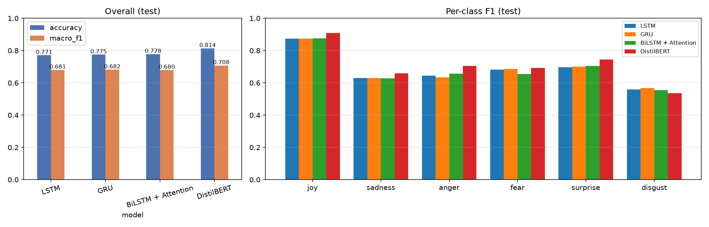

**Takeaways**

- **DistilBERT is the best model**: +3.6 pts accuracy and +2.6 pts macro-F1 over the best RNN. Contextual
  pre-training helps most on the harder, context-dependent classes (anger, surprise, sadness).
- The three GloVe-based RNNs are within ~0.2 pts macro-F1 of each other on test. **BiLSTM + Attention**
  has the best accuracy / weighted-F1 among them, converges much faster (0.63 validation macro-F1 after
  one epoch vs 0.40 for LSTM) and reaches the best validation macro-F1 of the RNNs (0.684 vs 0.683 GRU,
  0.674 LSTM — see curves below) and — most importantly — is **interpretable**.
- `disgust` (2 % of data) and `fear` (2 %) are the hardest classes; disgust is mostly confused with anger.
- Full per-class precision/recall is in [`reports/metrics/`](reports/metrics) and in the training logs.

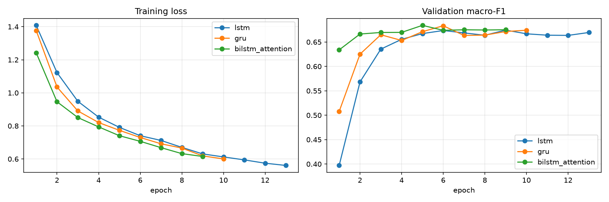

### Confusion matrices

| BiLSTM + Attention | DistilBERT |
|---|---|
| 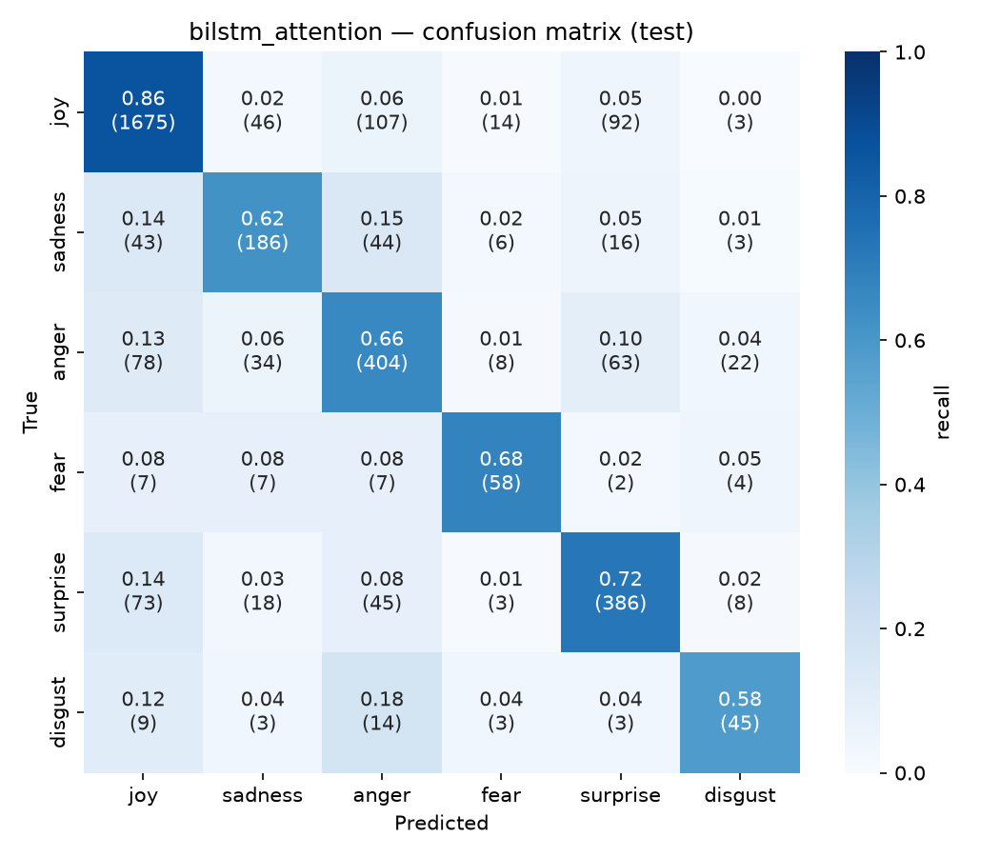 | 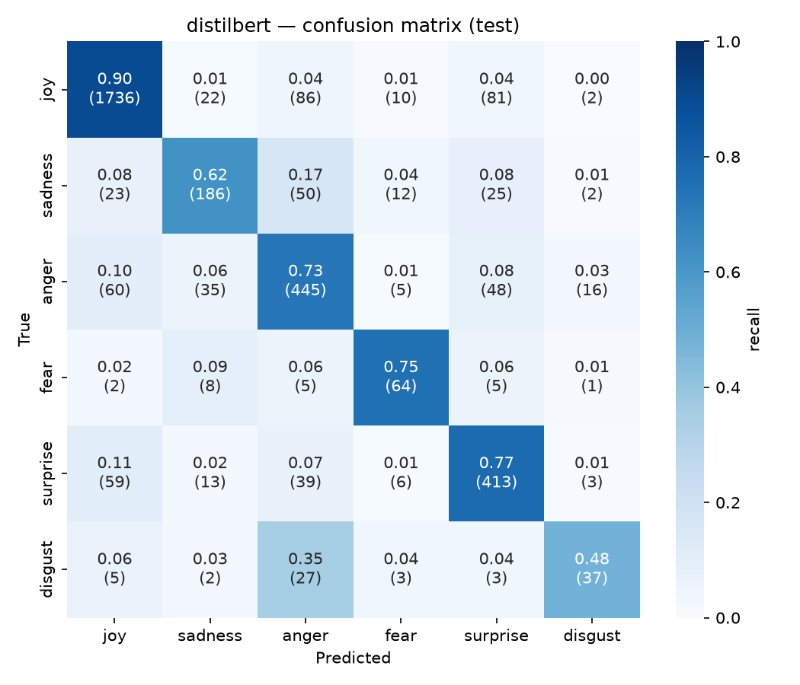 |
| **LSTM** | **GRU** |
| 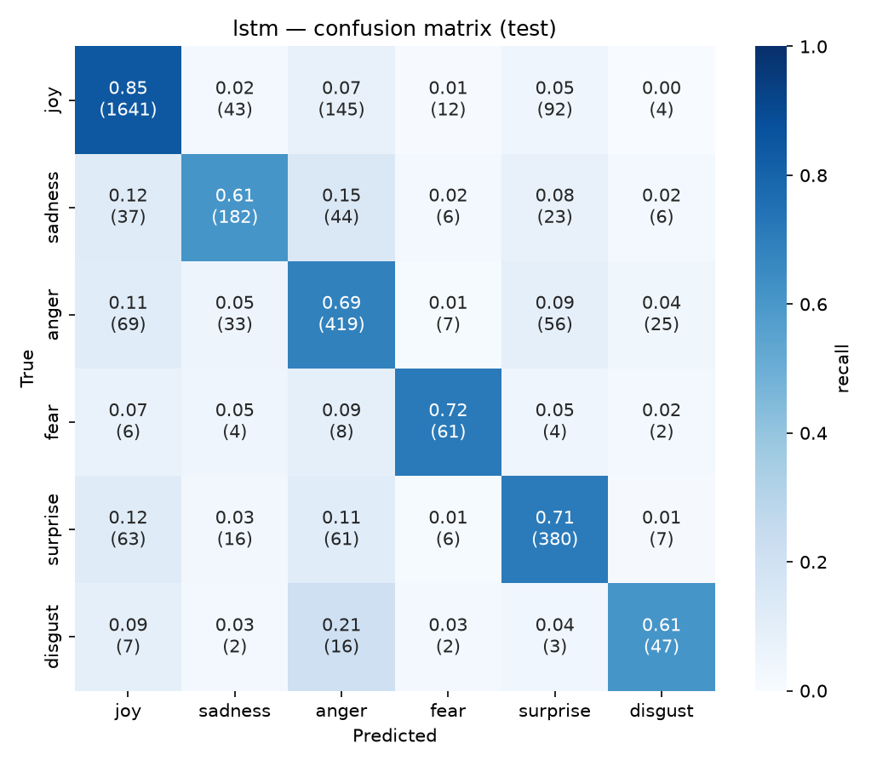 | 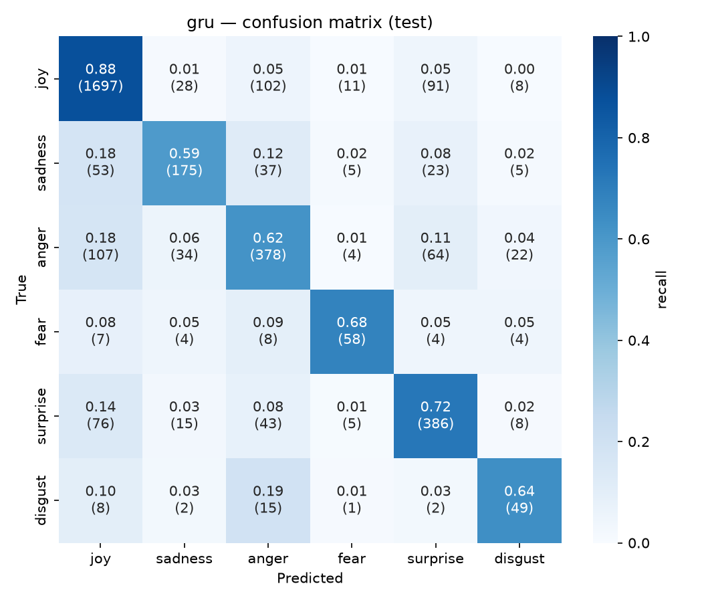 |

---

## Attention visualisation

Attention weights of the BiLSTM over each input token (darker = more attention):

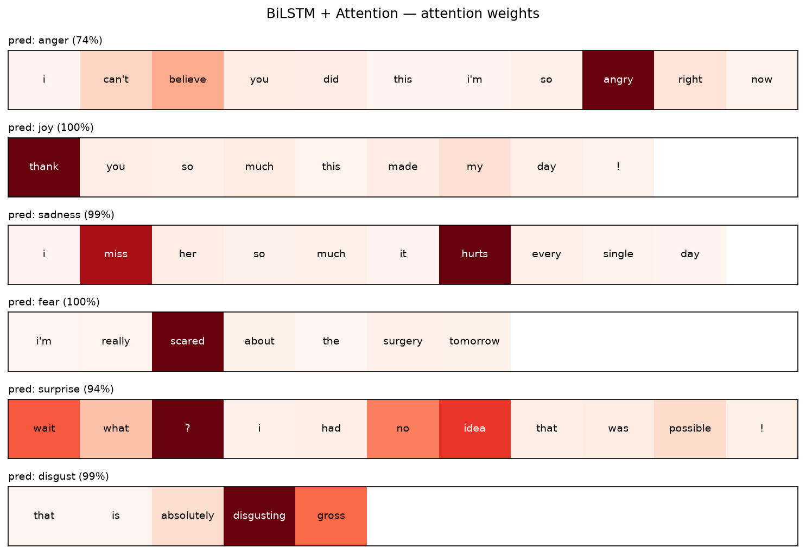

Correctly classified test examples, one per emotion:

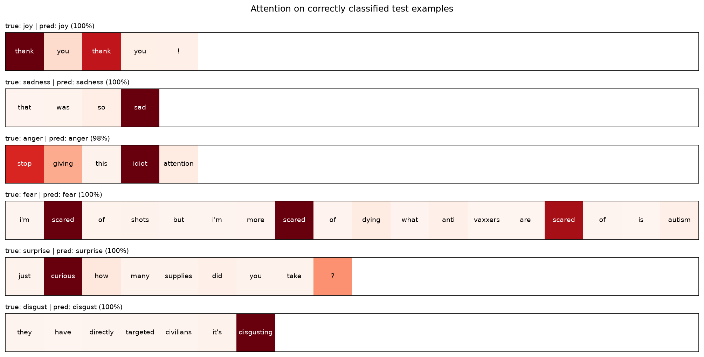

Words that receive the most attention mass over the whole test set, grouped by predicted emotion — the
model has learned emotion-bearing cue words (`thanks`, `love` → joy; `sorry`, `sad` → sadness; `?`, `wow`,
`curious` → surprise; `disgusting`, `worst` → disgust; `scared`, `afraid` → fear):

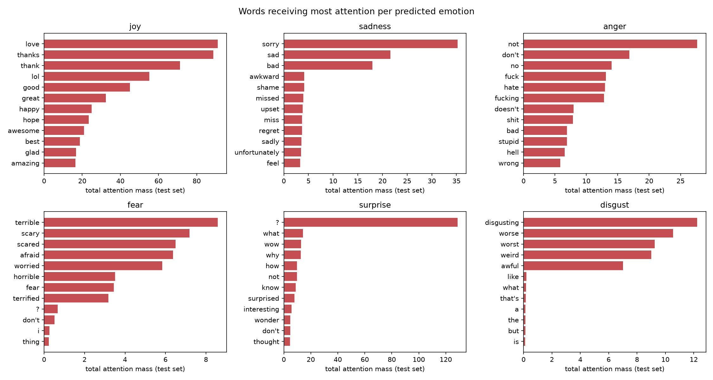

---

## Data

GoEmotions contains 58k Reddit comments labelled with 27 emotions + neutral (multi-label).
Labels are mapped to the 6 Ekman emotions with the **official mapping** from the GoEmotions repo
(`ekman_mapping.json`):

| Target | GoEmotions labels |
|---|---|
| joy | joy, amusement, approval, excitement, gratitude, love, optimism, relief, pride, admiration, desire, caring |
| sadness | sadness, disappointment, embarrassment, grief, remorse |
| anger | anger, annoyance, disapproval |
| fear | fear, nervousness |
| surprise | surprise, realization, confusion, curiosity |
| disgust | disgust |

To get a single-label multi-class problem, `neutral`-only comments are dropped and comments whose labels
map to **more than one** Ekman class are dropped as ambiguous.

| Split | Raw | After mapping |
|---|---|---|
| train | 43,410 | 28,104 |
| validation | 5,426 | 3,527 |
| test | 5,427 | 3,539 |

(train: 12,823 neutral-only and 2,483 conflicting examples removed)

| 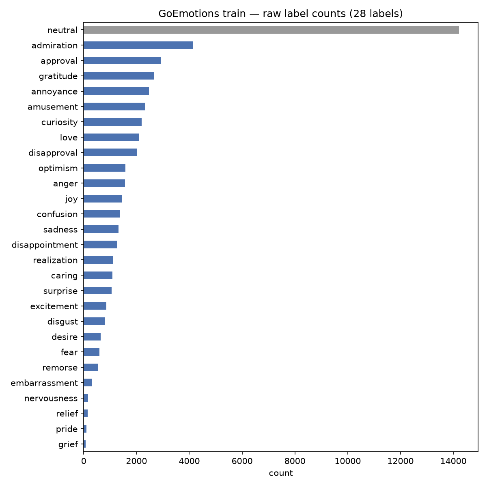 | 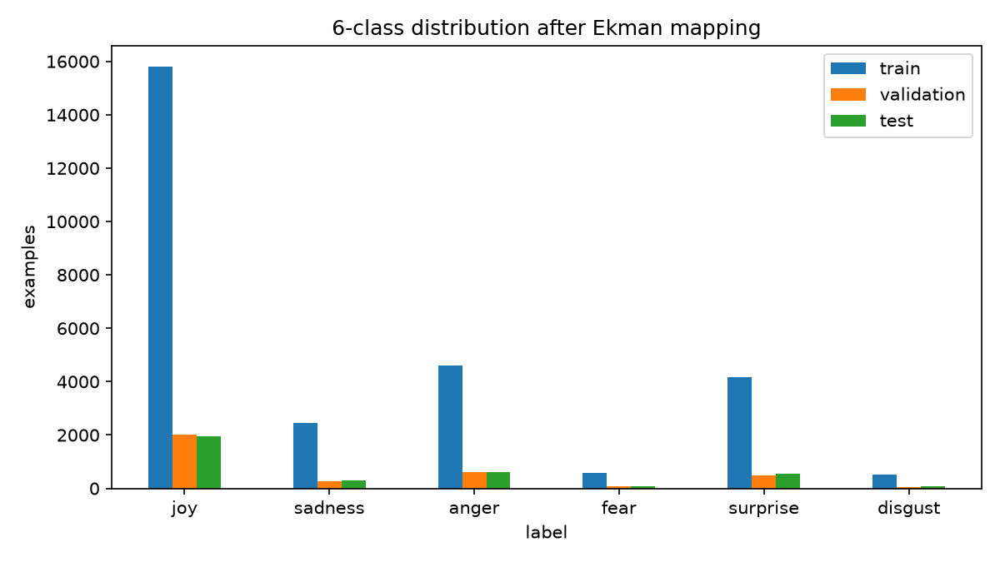 |
|---|---|

The data is heavily imbalanced (joy ≈ 56 %, disgust ≈ 2 %), so all models use **class-weighted
cross-entropy** (inverse-sqrt frequency) and are selected on **validation macro-F1**.

## Method

**Preprocessing** (`src/data.py`): HTML unescape, lowercase, replace URLs / users / subreddits / `[NAME]`
placeholders, squash character repetitions (`soooo` → `soo`), regex tokenisation keeping `!` and `?`,
vocabulary of tokens with frequency ≥ 2 (9,725 tokens, **96.2 % covered by GloVe**), sequences
padded / truncated to 40 tokens.

**Embeddings** (`src/embeddings.py`): embedding layer initialised from **GloVe 6B 100d**
(Wikipedia + Gigaword); unknown words initialised randomly, `<pad>` = 0; embeddings are fine-tuned.

**Models** (`src/models.py`)
- `LSTM` / `GRU`: embedding → dropout → 1-layer RNN (128 units, packed sequences) → last hidden state → linear.
- `BiLSTM + Attention`: embedding → BiLSTM (2×128) → **additive (Bahdanau) attention**
  `α_t = softmax(vᵀ tanh(W h_t + b))` with padding masked → context `Σ α_t h_t` → linear.
- Training: AdamW (lr 1e-3, wd 1e-4), batch 64, dropout 0.5, grad-clip 1.0, ReduceLROnPlateau,
  early stopping (patience 4) on validation macro-F1.

**Transformer** (`src/train_transformer.py`): `distilbert-base-uncased` + classification head,
HuggingFace `Trainer` with a weighted-loss subclass, lr 3e-5, batch 32, 4 epochs, linear warm-up 10 %,
fp16, best checkpoint (epoch 3) selected on validation macro-F1.

## Project structure

```
├── app.py                      # Gradio web app
├── requirements.txt
├── scripts/download_models.py  # fetches the fine-tuned DistilBERT from the GitHub release
├── src/
│   ├── config.py               # paths, label mapping, hyper-parameters
│   ├── data.py                 # loading, Ekman mapping, cleaning, tokenising, padding
│   ├── embeddings.py           # GloVe embedding matrix
│   ├── models.py               # LSTM, GRU, BiLSTM + Attention
│   ├── train_rnn.py            # trains + evaluates the 3 RNN models
│   ├── train_transformer.py    # fine-tunes DistilBERT with HF Trainer
│   ├── evaluate.py             # accuracy, macro-F1, per-class P/R, confusion matrix
│   ├── visualize_attention.py  # attention heatmaps
│   ├── compare.py              # comparison table + chart
│   ├── eda.py                  # exploratory analysis
│   └── predict.py              # inference helpers
├── models/                     # LSTM / GRU / BiLSTM checkpoints + vocab (DistilBERT via release)
└── reports/                    # figures, metrics JSON, training logs, results.md
```

## How to run

```bash
pip install -r requirements.txt          # + PyTorch with CUDA from pytorch.org if you have a GPU
```

**Just the app** (RNN checkpoints are in the repo; DistilBERT weights are in the v1.0 release):

```bash
python scripts/download_models.py
python app.py                            # → http://127.0.0.1:7860
```

**Reproduce everything**

```bash
# GloVe 100d (word2vec text format, ~128 MB)
mkdir -p data/glove
curl -L -o data/glove/glove-wiki-gigaword-100.gz https://github.com/RaRe-Technologies/gensim-data/releases/download/glove-wiki-gigaword-100/glove-wiki-gigaword-100.gz

python -m src.eda                  # data exploration figures
python -m src.train_rnn            # LSTM, GRU, BiLSTM+Attention (~3 min on a GTX 1660 Super)
python -m src.train_transformer    # DistilBERT (~40 min on a GTX 1660 Super)
python -m src.visualize_attention  # attention heatmaps
python -m src.compare              # results table + comparison chart
```

## App

Enter free text → the app returns the dominant emotion, a confidence bar chart across all 6 classes,
and the BiLSTM's attention over the words of the input. You can switch between DistilBERT and
BiLSTM + Attention.

## Limitations

- Reddit comments are short and informal; sarcasm and mixed emotions are common (e.g. "No way, I never
  expected that!" is classified as anger rather than surprise).
- Ambiguous multi-emotion and neutral comments were removed, so the model always picks one of 6 emotions
  and has no "neutral" option.
- Minority classes (fear, disgust) have < 600 training examples each.
